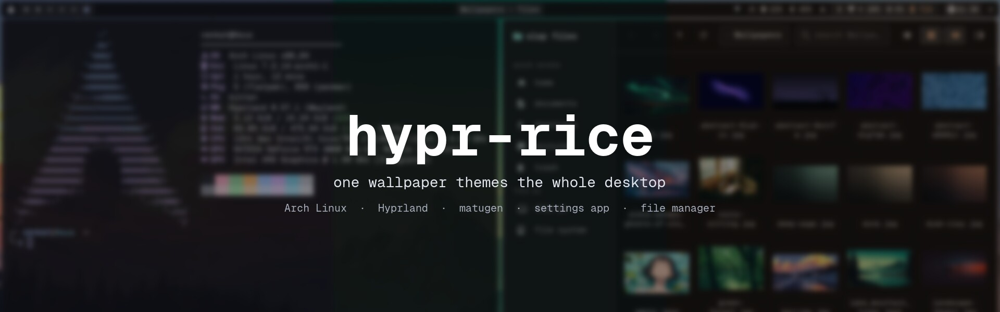
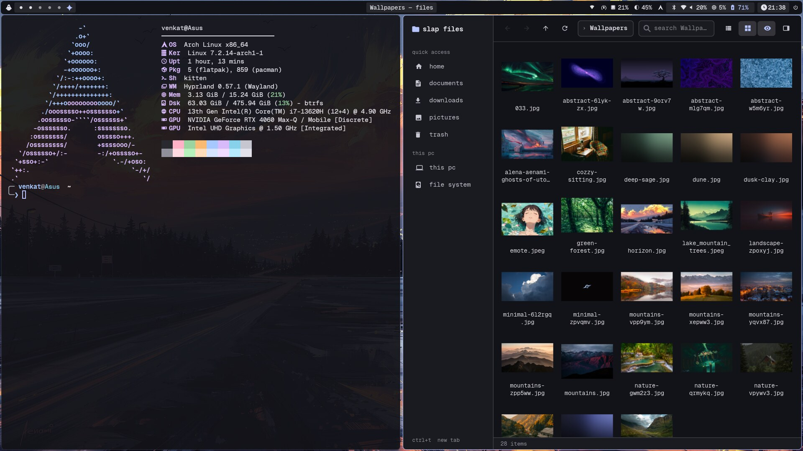
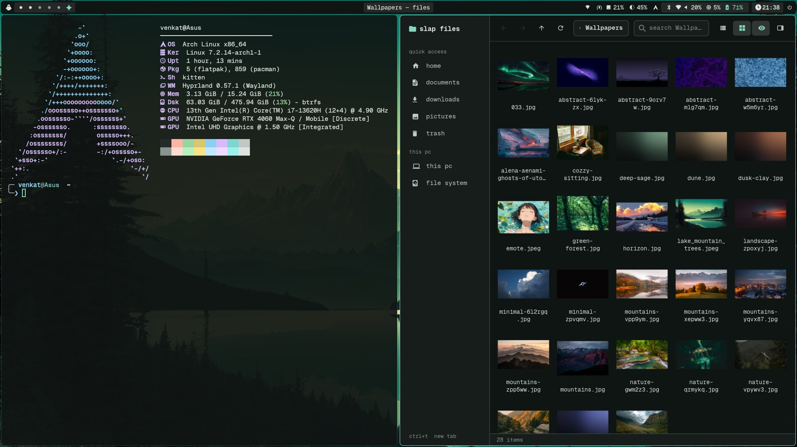
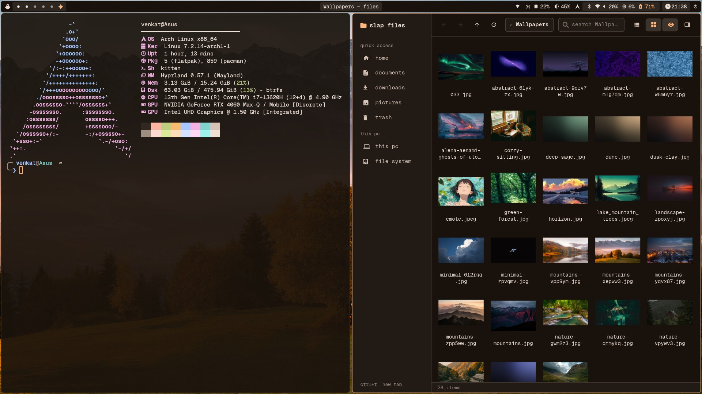
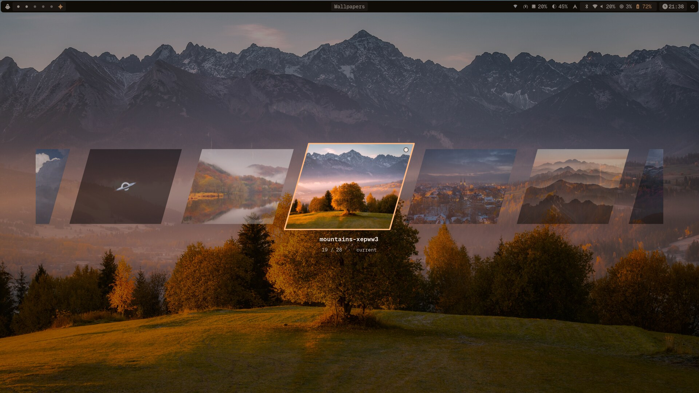
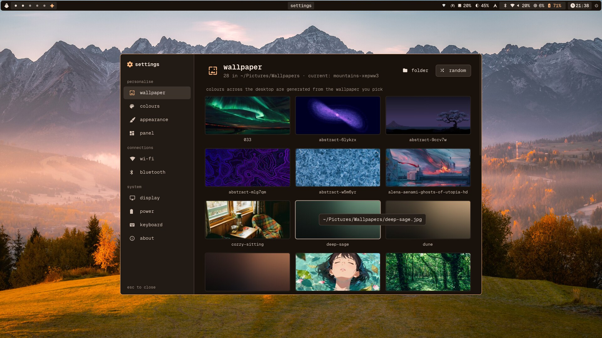
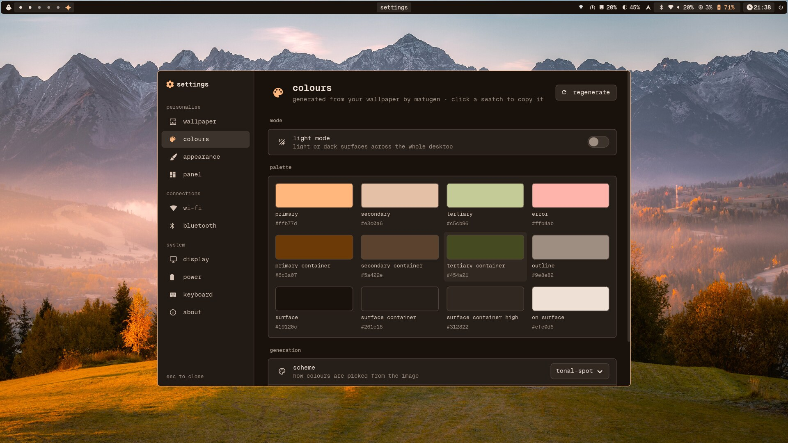
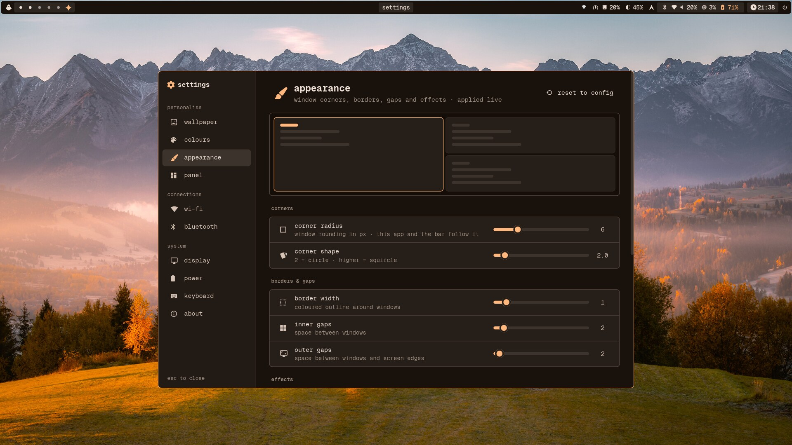
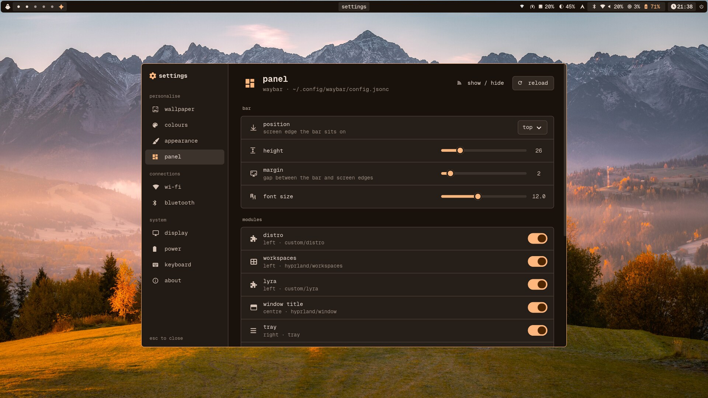
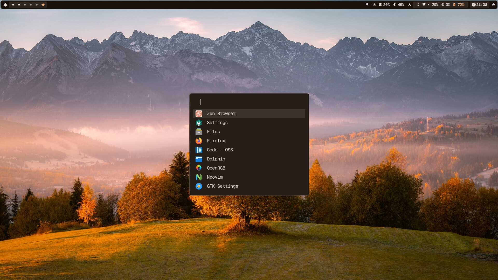

<p align="center">
  
</p>

<p align="center">
  
  
  
  
  
</p>

# hypr-rice

**A complete Hyprland desktop for Arch Linux that re-themes itself from your wallpaper.**
Pick an image and, about a second later, the window borders, bar, launcher, notifications,
terminal, lock screen, login screen, GTK apps and VS Code all share a palette generated from
it by [matugen](https://github.com/InioX/matugen) (Material You colours). Light and dark mode
are one switch.

It is a full setup, not only dotfiles:

- **Hyprland in Lua**: flat look, short animations, no blur or shadows, sensible tiling keybinds.
- **rice-settings**, a native settings app (Rust + GTK4, ~50 MB RAM): wallpaper, colours,
  appearance, bar layout, wi-fi, bluetooth, display, power and battery history, keyboard RGB.
- **slap-files**, a native Explorer-style file manager (Rust + GTK4): tabs, search, thumbnails,
  drag and drop, undo, archives, trash, drives with safe eject.
- **Wallpaper carousel, workspace overview with live thumbnails, and bar popups** for music
  (with album art), calendar and battery, all GTK4 and all following the palette.
- **Waybar** with dropdown panels for wi-fi, bluetooth, memory, power profile and power menu.
- **Matching lock screen (hyprlock) and login screen (SDDM)** that follow the wallpaper.
- **A transparent installer**: every package is listed with what it does, every command is
  shown before it runs, every step asks first, and replaced files are backed up.

Free for anyone to use, change and share: public domain ([Unlicense](LICENSE)).

## Screenshots

**Same desktop, three wallpapers.** Nothing was changed between these but the wallpaper.

| | | |
|---|---|---|
|  |  |  |

**Wallpaper carousel** (SUPER+W)



**Settings app** (SUPER+I)

| wallpaper | colours |
|---|---|
|  |  |
| **appearance** | **panel** |
|  |  |

**Launcher** (SUPER+Space)



## Nothing hidden

This repo is meant to be read before it is run.

- **Every package is listed with what it does** in [PACKAGES.md](PACKAGES.md). The installer
  reads the same lists ([`packages/`](packages/)), so there is no second, hidden list.
- **`./install.sh --list`** prints every package, every file it writes and every `sudo` command,
  and changes nothing. **`./install.sh --dry-run`** walks the whole install without touching anything.
- The installer **asks before each step**, **prints each command** before running it, and
  **backs up** any file it would overwrite to `~/.config/hypr-rice-backup-<date>/`.
- **No prebuilt binaries.** The two apps are compiled on your machine from [`apps/`](apps/).
  Everything else is plain text: Lua, bash, Python, CSS, QML.
- **No telemetry, no network calls**, with one exception: the music popup (`lyra`) downloads
  the album-art URL your media player reports.

## Install

On an Arch Linux system with a working network and a user that can `sudo`:

```sh
git clone https://github.com/Najeer-k11/hypr-rice.git
cd hypr-rice
./install.sh --list     # read what it will do
./install.sh            # do it, step by step
```

Then log out and pick the **Hyprland (uwsm-managed)** session. `SUPER+/` shows the keybinds.

The installer's steps, each optional (`./install.sh --only configs,scripts` runs just those):

| step | what happens | needs sudo |
|---|---|---|
| `packages` | installs the packages in [PACKAGES.md](PACKAGES.md) with `pacman -S --needed`, group by group; you can pick one by one | yes |
| `aur` | cursor theme, browser, pipes toy, through `yay` or `paru` if you have one | via the helper |
| `configs` | copies [`config/`](config/) to `~/.config/` | no |
| `scripts` | copies [`bin/`](bin/) to `~/.local/bin/` | no |
| `wallpapers` | creates `~/Pictures/Wallpapers/`; if it is empty, draws a plain starter gradient with ImageMagick | no |
| `apps` | builds `rice-settings` and `slap-files` with cargo, installs to `~/.local/bin/` | no |
| `theme` | sets GTK theme, icon theme, cursor and dark mode with `gsettings` | no |
| `palette` | runs matugen once so the first login already has colours | no |
| `services` | enables NetworkManager, bluetooth, power-profiles-daemon (asked one by one) | yes |
| `sddm` | installs the login theme to `/usr/share/sddm/themes/rice` and selects it in `/etc/sddm.conf.d/` | yes |
| `shell` | copies [`home/.zshrc`](home/.zshrc) to `~/.zshrc` | no |

Not installed: graphics drivers (install the right ones for your GPU first) and your everyday apps.

**Wallpapers are not included.** Put your own images in `~/Pictures/Wallpapers` (jpg, png, webp;
`rice-settings → wallpaper → folder` opens it) and they appear in the picker. To use another
folder, set the `WALL_DIR` environment variable.

Rerunning is safe. To remove it again: `./uninstall.sh` (it also tells you where your backups are).

## How the theming works

```
 SUPER+W (rice-wallpicker)  ─┐
 rice-settings → wallpaper  ─┼─▶  wall set <image>
 wall random / wall pick    ─┘        │
                                      ├─▶ awww img …             wallpaper, with a transition from the cursor
                                      ├─▶ matugen image …        palette from the image, fills the templates:
                                      │      ~/.config/hypr/colors.lua            borders        (hyprctl reload)
                                      │      ~/.config/hypr/hyprlock-colors.conf  lock screen
                                      │      ~/.config/waybar/colors.css          bar + all rice popups and apps
                                      │      ~/.config/fuzzel/colors.ini          launcher, panels
                                      │      ~/.config/mako/config                notifications  (makoctl reload)
                                      │      ~/.config/kitty/colors.conf          terminal       (SIGUSR1)
                                      │      ~/.config/gtk-{3,4}.0/colors.css     GTK apps
                                      │      ~/.cache/rice/vscode-colors.json     VS Code        (rice-vscode-sync)
                                      ├─▶ rice-sddm-sync         login screen gets the wallpaper + colours
                                      └─▶ rice-settings --sync-keyboard   RGB keyboard, if "follow wallpaper" is on
```

The whole pipeline is [`bin/wall`](bin/wall) (about 60 lines) plus
[`config/matugen/config.toml`](config/matugen/config.toml) and the templates next to it. To theme
another program, add a template and a `[templates.name]` block.

Scheme (tonal-spot, vibrant, …), contrast and light / dark mode are chosen in
`rice-settings → colours` and stored in `~/.config/rice/theme.env`, which `wall` reads.

## What is in the repo

```
install.sh  uninstall.sh     the installer (read it, it is one file)
PACKAGES.md                  every package and why (generated from packages/)
packages/*.txt               "package | what it does", one file per group
config/                      -> ~/.config
  hypr/hyprland.lua            compositor: look, animations, window rules, autostart
  hypr/binds.lua               keybinds
  hypr/hyprlock.conf           lock screen
  hypr/hypridle.conf           idle: dim, lock, screen off, suspend
  hypr/local.lua.example       template for your own machine-specific additions
  waybar/                      the bar
  matugen/                     palette config + one template per themed program
  fuzzel/ kitty/ gtk-3.0/ gtk-4.0/ fastfetch/ rice/
bin/                         -> ~/.local/bin (see the table below)
apps/rice-settings/          settings app, Rust + GTK4 (has its own README)
apps/slap-files/             file manager, Rust + GTK4 (has its own README)
sddm/                        login-screen theme (Qt6 QML)
docs/screenshots/            the images on this page
home/.zshrc                  -> ~/.zshrc
```

### The scripts

| script | what it does | where it is used |
|---|---|---|
| `wall` | sets the wallpaper and regenerates the palette (`set <file>`, `pick`, `random`, `restore`) | everything wallpaper-related; `restore` runs at login |
| `rice-wallpicker` | wallpaper carousel (GTK4 / Python) | SUPER+W, bar |
| `rice-overview` | workspace overview with live window thumbnails; type to filter, drag to move | SUPER+Tab |
| `rice-windows` | window switcher in the launcher | ALT+Tab |
| `lyra` | music module in the bar and a player popup with album art | bar |
| `rice-calendar` | month calendar popup | bar clock |
| `rice-battery` | battery popup with history; its `daemon` logs the battery and switches power profile on plug / unplug | bar battery, autostart |
| `rice-panel` | draws a dropdown under the bar item that was clicked (wraps fuzzel) | the panels below |
| `rice-wifi`, `rice-bt`, `rice-mem`, `rice-profile`, `rice-power` | wi-fi, bluetooth, memory / process, power-profile and power-menu panels | bar; SUPER+SHIFT+Escape |
| `rice-clickout` | closes an open panel when you click outside it | every mouse click (non-consuming bind) |
| `rice-osd` | changes volume / brightness and shows the popup | media keys |
| `rice-shot` | screenshot of a region or the screen, saved to `~/Pictures/Screenshots` and copied | Print, SUPER+SHIFT+S |
| `rice-clip` | clipboard history picker | SUPER+V |
| `rice-keys` | keybind cheatsheet | SUPER+/ |
| `rice-lockinfo` | the music / notifications / battery lines on the lock screen | hyprlock |
| `rice-sddm-sync` | copies the wallpaper and palette into the login theme | `wall` |
| `rice-vscode-sync` | merges the palette into VS Code / Code OSS / VSCodium `settings.json` (other keys untouched) | matugen hook |
| `rice-toy` | toggles the pipes terminal toy | SUPER+ALT+P |

## Keys

| key | action |
|---|---|
| SUPER + Return | terminal (SHIFT: floating) |
| SUPER + Space / R | launcher |
| SUPER + E | files (`slap-files`) |
| SUPER + B | browser (`zen-browser`) |
| SUPER + I | settings (`rice-settings`) |
| SUPER + W | wallpaper carousel (SHIFT: random, ALT: plain list) |
| SUPER + V | clipboard history |
| SUPER + Tab | workspace overview |
| ALT + Tab | window switcher (SHIFT: this workspace only) |
| SUPER + Q | close window |
| SUPER + F / M | fullscreen / maximize |
| SUPER + T / C / P | float / center / pin |
| SUPER + J / G | toggle split / group |
| SUPER + arrows or h, k | focus (SHIFT: move, CTRL: resize; all of h j k l) |
| SUPER + 1…0 | workspace (SHIFT: send window there) |
| SUPER + ` [ ] | last / previous / next workspace |
| SUPER + S | scratchpad (ALT: send window to it) |
| SUPER + N | do not disturb (SHIFT: clear notifications) |
| SUPER + CTRL + B | hide / show the bar |
| Print or SUPER + SHIFT + S | screenshot region (SHIFT + Print: whole screen) |
| SUPER + L or Escape | lock |
| SUPER + SHIFT + Escape | power menu |
| SUPER + / | this list, on screen |

All of them are in [`config/hypr/binds.lua`](config/hypr/binds.lua).

## Making it yours

- **Monitors.** The config uses every output at its preferred mode. Set resolution, refresh rate
  and scale in `rice-settings → display`, or in `~/.config/hypr/local.lua`.
- **Your own binds, rules, keyboard layout** go in `~/.config/hypr/local.lua`
  (start from `local.lua.example`). It is loaded last and the installer never overwrites it.
- **Another browser / terminal.** Change the `exec(...)` lines at the top of `binds.lua`.
- **Rounding, gaps, borders, blur, animations, bar layout** are in `rice-settings`. It writes
  `~/.config/hypr/settings.lua`; delete that file to return to the defaults.
- **Wallpapers.** Drop images into `~/Pictures/Wallpapers`. For another folder, set `WALL_DIR`,
  for example `hl.env("WALL_DIR", "/path/to/walls")` in `local.lua`.

## Hardware notes

Built and used on an ASUS laptop with Intel + NVIDIA graphics, 1920×1080.

- **ASUS extras** (keyboard RGB, charge limit) need `asusctl` and are simply absent elsewhere.
- **Hybrid NVIDIA laptops.** `GSK_RENDERER=gl` is set so GTK4 apps do not wake the sleeping
  dGPU on every launch (that costs about 2 s and battery). Harmless on other machines.
  The battery popup's "NVIDIA GPU" line assumes the dGPU is at PCI address `0000:01:00.0`.
- **Battery.** The battery and AC adapter are detected by type; the login screen reads `BAT0`.
- **Desktops** work; the battery, backlight and profile modules just stay empty.

## Requirements

Arch Linux (or a derivative with the same repos), Hyprland **0.57 or newer** (the config is
Lua, not `hyprland.conf`), and a GPU driver that runs Hyprland.

## Credits

- [Hyprland](https://hyprland.org), [matugen](https://github.com/InioX/matugen),
  [awww](https://codeberg.org/LGFae/awww), [Waybar](https://github.com/Alexays/Waybar),
  [fuzzel](https://codeberg.org/dnkl/fuzzel), [mako](https://github.com/emersion/mako),
  [kitty](https://sw.kovidgoyal.net/kitty/)
- Bar layout adapted from [atif-1402/minimal-waybar-themes](https://github.com/atif-1402/minimal-waybar-themes) (MIT)
- Geist Mono (Vercel) patched by [Nerd Fonts](https://www.nerdfonts.com), Papirus icons, Bibata cursors, adw-gtk3
- The wallpapers in the screenshots are not part of this repo and belong to their creators

## Licence

Public domain ([Unlicense](LICENSE)). Anyone can use, copy, change, share or sell the configs,
scripts and both apps, for any purpose, without asking and without credit.

## Tags

`hyprland` `hyprland-dotfiles` `hyprland-rice` `hyprland-lua` `arch-linux` `dotfiles` `rice`
`linux-rice` `unixporn` `wayland` `matugen` `material-you` `dynamic-theming` `wallpaper-theming`
`waybar` `hyprlock` `hypridle` `sddm-theme` `fuzzel` `mako` `kitty` `awww` `swww` `gtk4` `rust`
`settings-app` `file-manager` `wallpaper-picker` `workspace-overview` `install-script`
`linux-desktop` `tiling-window-manager` `linux-customization`
